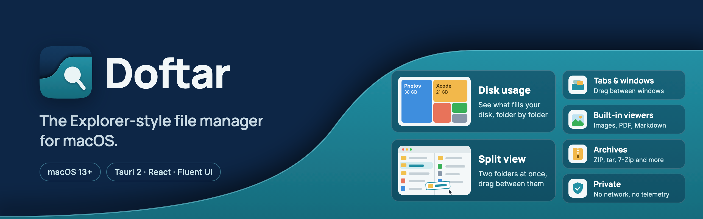

# Doftar

A file manager for macOS with an **Explorer-style** layout, made for people
coming from Windows. Built with Tauri 2 + React 18 + the MIT-licensed Fluent
UI v9.


[](https://mhbsiam.github.io/doftar/)

**Website:** <https://mhbsiam.github.io/doftar/>

Runs on **macOS 13 Ventura or later** with nothing else to install: thumbnails,
Quick Look, search and archives all use tools that ship with macOS.

## Features

- Explorer-style layout: tab strip, command bar, breadcrumb address bar,
  left navigation pane, status bar
- **Home page** with Quick access tiles, Favorites, and Recent files
- Real filesystem browsing: details view (sortable columns) and grid view with
  cached image thumbnails (rendered once with the system `sips`, so HEIC works
  and big photos are never decoded at icon size); lists are virtualized, so
  folders with tens of thousands of items stay fast
- Keyboard-first file list (arrows, Shift ranges, Home/End, type-ahead, Menu
  key), WCAG 2.1 AA contrast, reduced-motion support, and an adjustable text
  size (Options > Text size)
- Draws at the display's full refresh rate, so motion runs at 120 Hz on a
  ProMotion display (WebKit would otherwise pace pages at 60)
- Tabs with per-tab back/forward/up history. Drag a tab along the strip to
  reorder it, or pull it off the strip (or right-click → **Move to new
  window**) to open it in a window of its own. Drop it on another window's
  tab strip to move it there (a caret shows where it will land); a window
  whose last tab leaves closes. Favorites, settings and the clipboard stay in
  step across windows
- File operations: cut/copy/paste (through the system pasteboard, so it works
  with Finder in both directions), rename (inline), delete to Trash,
  permanent delete, new folder / text document. Pasting or dropping onto an
  existing name asks **Replace / Skip / Keep both** (Replace sends the old
  item to the Trash, so it is undoable); pasting into the same folder makes
  a " - Copy". Finder aliases show the shortcut arrow, and opening one to a
  folder browses the original here
- **Compress to ZIP** and **Extract here** for zip, tar (gz, bz2, xz), 7-Zip,
  RAR, ISO, CAB, XAR, cpio and LHA, using macOS's built-in `ditto` and `tar`,
  so no separate unarchiver is needed
- **Image viewer**: images opened in Doftar show in its own viewer window.
  An image opened from a folder flies out of its thumbnail into the window,
  and back into it when the viewer closes.
  Step through the folder's other images with the arrow keys, a two-finger
  swipe or the side buttons, in the order the folder is listed. Pinch or
  `⌘+`/`⌘−` to zoom, drag to pan, and double-click for 100%. Rotate (`L`/`R`),
  flip (`H`/`V`) and crop (`C`, with aspect-ratio presets), then **Save** (`⌘S`)
  over the original or **Save as a copy** (`⇧⌘S`); edits apply to the image as
  shown, EXIF orientation included, and a plain rotation of a JPEG, HEIC or
  TIFF only rewrites its orientation tag, so it loses no quality. HEIC and camera
  RAW go through `sips`. **Open with → Preview** (or the viewer's **Open in
  Preview** button) still opens Preview, and Finder's default app is left alone
- **Markdown reader**: `.md` files open formatted in their own window, with
  tables, syntax-coloured code blocks (with a copy button), task lists, GitHub
  alerts, footnotes and an outline of the headings. Links to other Markdown
  files open in the reader (with back and forward), web links in the browser.
  Doftar draws every element itself and never inserts the document's HTML, so
  a file can't run script; images from the web show as links, since Doftar
  stays offline. **Open in …** hands the file to its default editor
- **Text and code** open in the same reader: `.txt` and logs wrap like prose,
  and source files (Python, JavaScript/TypeScript, Rust, Swift, Go, C/C++,
  shell, JSON, YAML and more) show coloured by language with line numbers.
  Doftar checks the file really is text first, so a `.ts` video still opens
  in its player
- **PDF viewer**: PDFs open in Doftar's own window, drawn by macOS's PDFKit
  (the engine Preview uses), with page thumbnails, page numbers, zoom, two
  pages side by side, find, and password-protected files. Links in a PDF open
  only web and mail addresses, never files or apps. **Open in Preview** is a
  click away
- **Open with** in the file menu (apps macOS offers for the type, plus
  "Choose another app…")
- **Properties** with live folder sizes (and size on disk), permissions, Finder
  tags, the default app and a combined view for multi-selection; **Copy as
  path** (`⌥⌘C`); sizes and dates update in place when a file is written
  from another app
- **Eject** for external and network volumes (Drives list: hover button or
  right-click), **Empty Trash**, and **Put Back** in the Trash
- Search filters the open folder as you type; press **Enter** or click
  **Subfolders** to search the whole subtree (Spotlight, with a bounded
  folder walk where Spotlight is off), then **Open file location** on a hit
- Undo / redo (last 50 operations, this session): rename, move, copy, new
  item and Trash. Trashing doesn't ask first; undo it instead. Items fly
  where they go: into the Trash, a folder, a tab or a breadcrumb, and back
  into their rows on undo
- Copy and move run as jobs with a progress card (bytes, speed, time left) and
  a Cancel button; a cancelled or failed cross-volume move never leaves a
  half-copied duplicate
- Explorer-style right-click menus (a command row, shortcut hints,
  submenus) everywhere, plus **Open in Terminal** (`⌥⌘T`) on folders, the
  folder background and the address bar's folder menu. It uses your default
  terminal; the **Open in** submenu lists the other installed ones (Terminal,
  iTerm2, Warp, Ghostty, WezTerm, Zentty) plus any app added with "Choose
  another app…", and
  the one you pick becomes the default. The address bar runs commands too:
  type something that isn't a path or a folder here (`claude`, `codex`,
  `git status`) and it opens in the default terminal in the current folder.
  Terminal, iTerm2, Warp, Ghostty and WezTerm take the command straight;
  Zentty (which can't be handed one from outside) or an app added by hand
  opens in the folder with the command on the clipboard
- Live refresh via a kqueue watcher on the open folder only (no manual F5
  needed, and nothing deeper in the tree triggers reloads)
- Drag & drop, Finder-style: drag files onto a folder, a nav pane entry, a tab
  or a breadcrumb to move them (same volume) or copy them (other volume);
  hold Option to force a copy, drop on Trash to trash, drop a folder on
  Favorites to pin it. Hovering a folder or tab while dragging opens it. Drag
  out of the window to hand files to Finder, Mail, Slack or a browser upload
  (copies). Files dragged in from Finder are copied into the folder under the pointer
- Light, dark and **system** (follows macOS appearance) Fluent themes;
  hidden-files toggle that also honours macOS's `UF_HIDDEN` flag (`~/Library`…)
- macOS-aware: `.app`/`.pages`/`.bundle`… packages open like files (right-click
  → **Show Package Contents** to browse inside), symlinks get a shortcut-arrow
  badge, copies keep Finder tags / xattrs / ACLs via `copyfile(3)`
- Native macOS menu bar (File / Edit / View / Go / Window / Help) with
  Finder-style shortcuts; Windows Ctrl/Alt shortcuts keep working too

### Keyboard shortcuts

Mac keys first; the Windows-style keys in the right column also work.

| Action | Mac | Windows-style |
|---|---|---|
| Copy / Cut / Paste | `⌘C` / `⌘X` / `⌘V` | `Ctrl + C / X / V` |
| Move item here (paste as move) | `⌘⌥V` | |
| Undo / Redo | `⌘Z` / `⇧⌘Z` | `Ctrl + Z / Shift + Z` |
| Select all | `⌘A` | `Ctrl + A` |
| Quick Look (tap to toggle, hold to peek) | `Space` | |
| Move to Trash | `⌘⌫` | `Delete` |
| Delete immediately | `⌘⌥⌫` | `Shift + Delete` |
| New folder / text document | `⌘⇧N` / `⌘⇧T` | `Ctrl + Shift + N / T` |
| New tab / close tab | `⌘T` (or `⌘N`) / `⌘W` | `Ctrl + T / W` |
| Move focused tab left / right | `⌘⇧←` / `⌘⇧→` | `Ctrl + Shift + ← / →` |
| Close window | `⌘⇧W` | |
| Open selection | `⌘↓` | `Enter` |
| Properties | `⌘I` | |
| Rename | `F2` | `F2` |
| Open in default terminal | `⌥⌘T` | |
| Back / Forward | `⌘[` / `⌘]` | `Alt + ← / →` |
| Enclosing folder | `⌘↑` | `Alt + ↑` |
| Go to Folder… (edit address) | `⌘⇧G` | |
| Home / Desktop / Documents / Downloads / Applications | `⌘⇧H` / `⌘⇧D` / `⌘⇧O` / `⌘⌥L` / `⌘⇧A` | |
| Icons / Details view | `⌘1` / `⌘2` | |
| Toggle hidden files | `⌘⇧.` | `Ctrl + H` (`⌘H` stays macOS Hide) |
| Search | `⌘F` | `Ctrl + F` |
| Refresh | `⌘R` | `Ctrl + R` or `F5` |

## Run it

Prerequisites: Node ≥ 18, Rust (`rustup`), macOS.

```sh
npm install
npm run tauri dev
```

First Rust build takes a few minutes; subsequent ones are incremental.

Production bundle:

```sh
npm run tauri build
```

Outputs:

- `src-tauri/target/release/bundle/dmg/Doftar_<version>_aarch64.dmg`: installable DMG
- `src-tauri/target/release/bundle/macos/Doftar.app`

Rebuild notes:

- Builds are incremental; only the first one takes a few minutes.
- The bundle is **unsigned**, so Gatekeeper warns when opening it on machines
  other than the build machine. Right-click and choose Open to bypass, or run `xattr -cr`
  on the installed app. Distributing beyond that requires signing +
  notarization with an Apple Developer ID.
- The DMG targets the build machine's architecture (`aarch64` on Apple
  Silicon). For an Intel/universal build:
  `rustup target add x86_64-apple-darwin aarch64-apple-darwin` then
  `npm run tauri build -- --target universal-apple-darwin`.

## Security and privacy

Doftar is local-first: nothing you browse, search or preview leaves your Mac
through it. In short (the details, and what Doftar stores where, are in
[SECURITY.md](SECURITY.md)):

- **No network.** No update check, telemetry or crash reporting. The process
  runs in a sandbox that refuses every IP socket, the webview can only reach
  the app's own files, and the build fails if a networking crate ever enters
  the dependency graph. Web links in documents open in your browser.
- **Downloads stay quarantined.** Anything extracted from a downloaded archive
  keeps macOS's quarantine mark, so Gatekeeper checks an app or script inside
  it on first run, as it would after Finder. Properties shows where a
  download came from.
- **Nothing runs without asking.** Opening a script or program, or handing a
  file to a terminal, asks first, and the Rust side refuses to do it without
  that confirmation. Links in a document never run programs.
- **Documents can't run code.** Markdown, text and code are drawn element by
  element from a Rust parser; PDFs are drawn by PDFKit and their links may
  only open web and mail addresses.
- **Thumbnails are private.** The cache is readable by you alone and excluded
  from Time Machine; previews of other volumes are deleted when the volume is
  ejected, and **Options → Privacy** can turn them off altogether.

## Releasing

Doftar makes no network connections: there is no update check, telemetry or
crash reporting. New versions are installed by downloading a release and
replacing the app.

To publish a release:

1. Raise `version` in `src-tauri/tauri.conf.json` and push.
2. On GitHub, open **Actions → Release → Run workflow**. It builds a universal
   (Apple Silicon + Intel) app, tags `v<version>` and publishes the release
   with the DMG, a `SHA256SUMS` file and a build provenance attestation
   (`gh attestation verify Doftar_<version>_universal.dmg --repo <owner>/doftar`).

The `release` environment the workflow runs in can be given required
reviewers in the repository settings.

## macOS permissions (TCC)

The first time you browse **Desktop, Documents, Downloads**, or an external
volume, macOS asks for folder access. Click OK. If you denied a prompt, grant
access in **System Settings → Privacy & Security → Files and Folders** (or
Full Disk Access) for Doftar.

Moving to Trash uses `NSFileManager` directly rather than scripting Finder, so
there is **no "Doftar wants to control Finder" Automation prompt** and no
Finder sound. Doftar remembers where it trashed things from, so **Put Back**
works for those items without Finder. Items trashed elsewhere (e.g. in Finder)
are put back by asking Finder, which triggers the one-time Automation prompt.
Emptying the Trash covers `~/.Trash` and the current user's per-volume
Trashes (`/Volumes/*/.Trashes/<uid>`).

## Project layout

```
src/                    React frontend (Fluent UI v9, Zustand stores)
  components/           title bar, command bar, address bar, nav pane, views
  stores/               tabs, clipboard, history, jobs, settings, appdata, ui
  hooks/                directory listing and watcher, system info, shortcuts
  util/                 formatting, file kinds, naming, view transitions
src-tauri/              Rust core
  src/fsops.rs          list, copy, move, rename, trash, volumes, undo steps
  src/jobs.rs           cancellable jobs, throttled progress events
  src/clipboard.rs      NSPasteboard file-URL read and write
  src/openwith.rs       Open With app list (NSWorkspace), launching, run-confirmation gate
  src/guard.rs          locations that are never moved, trashed or deleted
  src/netguard.rs       Seatbelt profile that denies the process every IP socket
  src/quarantine.rs     quarantine mark propagation and download origin
  src/search.rs         recursive filename search (mdfind, bounded-walk fallback)
  src/props.rs          Properties data: item info, cancellable folder size
  src/trash.rs          Empty Trash, Finder put-back fallback, volume eject
  src/thumbs.rs         cached thumbnails via sips and the Quick Look thumbnail service
  src/watcher.rs        refcounted kqueue watcher, one fd per open folder
  src/menu.rs           native macOS menu bar
  src/store.rs          persisted pins, favorites and recents
deny.toml               cargo-deny policy: licenses and the no-network crate ban list
assets/                 icon source drawings (SVG)
scripts/gen-icons.mjs   regenerates all bundle icons (needs rsvg-convert: brew install librsvg)
scripts/gen-notices.mjs regenerates THIRD_PARTY_NOTICES.md
```

## Contributing

Issues and pull requests are welcome. Keep the project under permissive licenses only: do not add
GPL, LGPL or AGPL dependencies, and run `npm run notices` after changing
dependencies. Before opening a pull request, make sure these pass:

```sh
npm run build
npm test
cargo test --manifest-path src-tauri/Cargo.toml
```

## License

Doftar is released under the [Apache License 2.0](LICENSE).

Third-party software shipped with the app (npm and Rust dependencies, with
full license texts) is listed in [THIRD_PARTY_NOTICES.md](THIRD_PARTY_NOTICES.md),
which is also bundled into the app. Regenerate it after changing dependencies:

```sh
npm run notices
```

All dependencies are under permissive licenses (MIT, Apache-2.0, BSD, Zlib,
Unicode) except five MPL-2.0 crates (`cssparser`, `cssparser-macros`,
`selectors`, `dtoa-short`, `option-ext`), which are used unmodified; see the
notices file for what that requires. There is no GPL, LGPL or AGPL code.

### What is, and is not, included

- UI components and icons: Microsoft **Fluent UI** and **Fluent System Icons**
  (MIT). Folder, file, drive and window-control glyphs are original drawings
  in this repo, not copied from Windows.
- **No Microsoft fonts or assets are bundled.** Text uses the macOS system
  font (San Francisco); the font stack names no Microsoft fonts. Never add
  Segoe UI files to this repo.
- No Windows logos, wordmarks, wallpapers, sounds or screenshots.
- UI wording avoids Microsoft-specific product strings (for example "This PC").

### Trademarks

*Windows*, *Segoe* and *Fluent* are trademarks of Microsoft Corporation;
*Finder* and *macOS* are trademarks of Apple Inc. Doftar is an independent
project for people coming from Windows, and is not affiliated
with, sponsored by, or endorsed by Microsoft or Apple. Do not distribute it
under a name or icon that implies otherwise.
