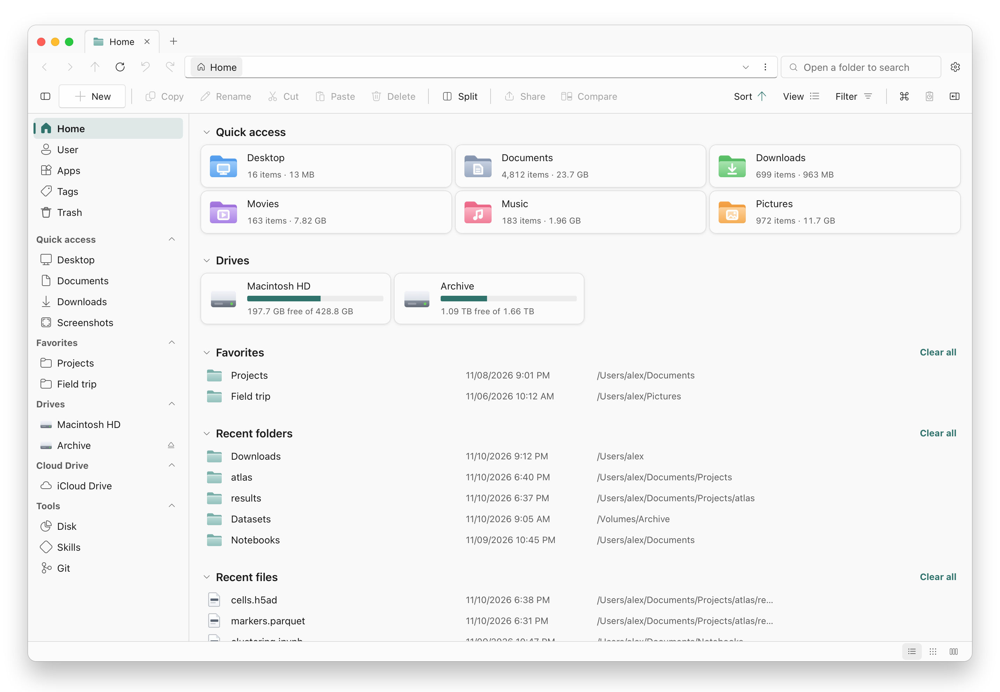
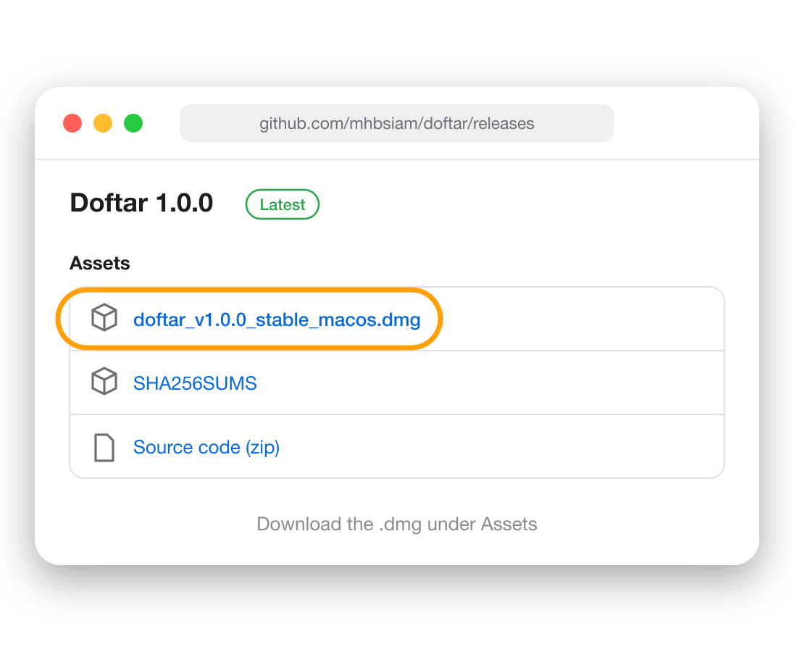
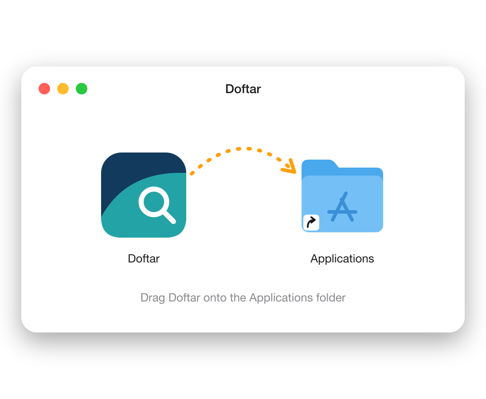
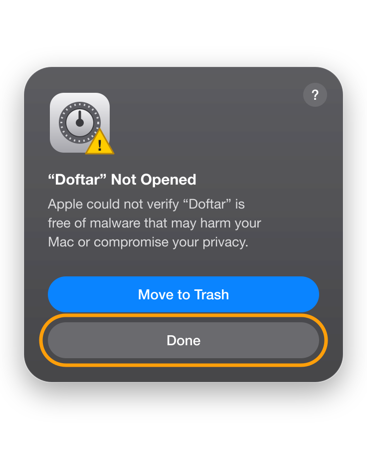
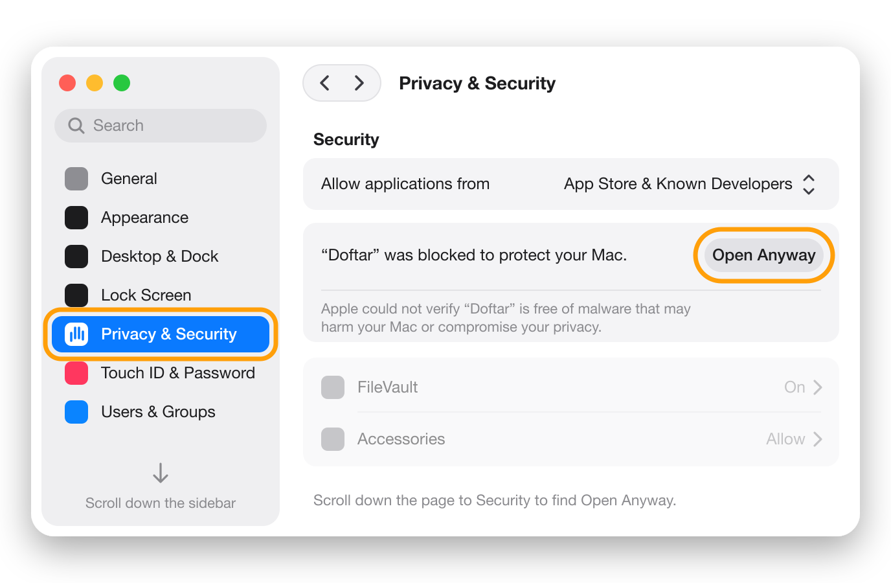
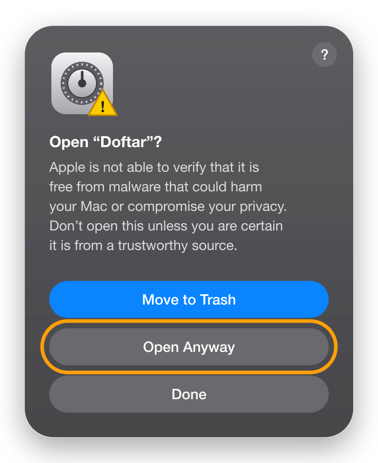
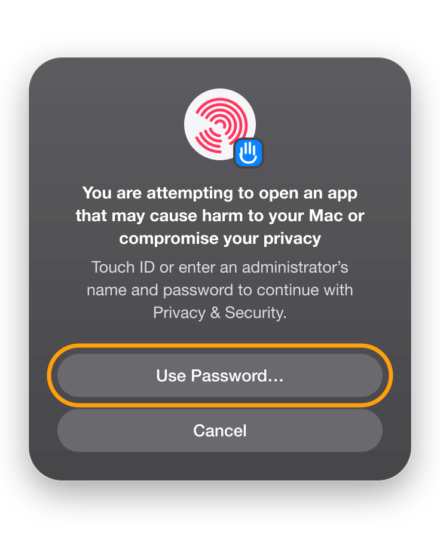

<p align="center">
  
</p>

<h1 align="center">Doftar</h1>

<p align="center">A free, offline macOS file manager with tabs, split view and built-in viewers for code, data and notebooks.</p>

<p align="center">
  <a href="https://github.com/mhbsiam/doftar/releases/latest">Download</a> &middot;
  <a href="https://doftar.app/">Website</a> &middot;
  <a href="docs/REFERENCE.md">Full feature list</a>
</p>

<p align="center">
  
</p>

https://github.com/user-attachments/assets/e5379363-4909-4fb3-9372-5589b93f157a

Doftar is a Mac file manager that opens your data. Parquet, AnnData, SQLite,
notebooks, PDFs and code open in built-in viewers, next to the folders they
live in. It runs on Apple silicon Macs, is tested on macOS 27 and needs nothing
else installed.

## Why Doftar

- **Tabs and split view.** Two folders in one window, each with its own tabs.
- **An address bar you can type into**, and a folder tree with sizes and size bars.
- **Your data, read in place.** Tables, AnnData, SQLite, notebooks and model weights, without opening Python.
- **No network.** No update check or telemetry. Doftar has no networking code, and a sandbox blocks network sockets in its main process.

## Install

1. Download `doftar_v<version>_stable_macos.dmg` from **Assets** on the
   **[latest release](https://github.com/mhbsiam/doftar/releases/latest)**.
2. Open the DMG and drag **Doftar** onto **Applications**.
3. Open Doftar. It isn't notarized yet, so macOS says it can't verify it.
   Click **Done**, not Move to Trash.
4. Open **System Settings**, scroll down the sidebar to **Privacy & Security**,
   then scroll down the page to Security and click **Open Anyway** next to the
   message about Doftar.
5. macOS asks once more. Click **Open Anyway**.
6. Use Touch ID, or click **Use Password…** and enter your Mac password. You
   only do this once.

<table>
  <tr>
    <td align="center"><a href="docs/assets/install/1-download.png"></a><br /><sub>1 · Download</sub></td>
    <td align="center"><a href="docs/assets/install/2-drag.png"></a><br /><sub>2 · Drag</sub></td>
    <td align="center"><a href="docs/assets/install/3-done.png"></a><br /><sub>3 · Done</sub></td>
  </tr>
  <tr>
    <td align="center"><a href="docs/assets/install/4-settings.png"></a><br /><sub>4 · Settings > Privacy & Security > Open Anyway</sub></td>
    <td align="center"><a href="docs/assets/install/5-open-anyway.png"></a><br /><sub>5 · Open Anyway</sub></td>
    <td align="center"><a href="docs/assets/install/6-password.png"></a><br /><sub>6 · Touch ID</sub></td>
  </tr>
</table>

### Prefer A Shortcut? 
First, drag Doftar onto Applications, open terminal, and run the following code:

```sh
xattr -cr /Applications/Doftar.app
```
For safety and good practice, to avoid installing a damaged or altered package, please verify the
download first. Find the `SHA256SUMS` file from the same Github release page, and run:

```sh
shasum -a 256 -c SHA256SUMS
# Optional, with the GitHub CLI: check the build provenance
gh attestation verify doftar_v<version>_stable_macos.dmg --repo mhbsiam/doftar
```

## Features

### Layout and navigation

- Explorer-style tab strip, command bar, breadcrumb address bar, navigation pane and status bar
- Home page with Quick access, Favorites, Recent folders and Recent files
- Tabs with their own back / forward / up history
- Drag tabs to reorder, pull one out into a new window, or drop it on another window's tab strip
- Favorites, settings and the clipboard stay in sync across windows
- Native macOS menu bar with Finder shortcuts; Windows Ctrl/Alt shortcuts work too
- Open a folder from outside: `open -a Doftar <folder>` in Terminal, or drop it on the Dock icon. In Finder, right-click → Services → **Reveal in Doftar** shows an item in its folder

### Browsing

- List view (sortable columns), column view, and icon view in four sizes
- Cached thumbnails, HEIC included
- Fast with tens of thousands of items
- Live refresh of the open folder, no F5 needed
- Search the open folder as you type; press Enter to search all subfolders
- Filter a folder or its search results by kind (images, documents, code…) and date modified
- A sparkle marks items changed in the last day
- Show or hide hidden files, including macOS-hidden ones like `~/Library`
- App bundles open like files; **Show Package Contents** browses inside
- Shortcut arrows on symlinks and Finder aliases
- **Preview bar** (⇧⌘P): double-click or Enter shows a file beside the listing instead of opening it
- **Tags** and **Screenshots** pages gather every file with a Finder tag, or every screenshot in your home folder
- Mouse side buttons and a sideways two-finger swipe go Back and Forward

### File operations

- Cut, copy and paste, shared with Finder in both directions
- Rename inline, new folder, new text document, **New Folder with Selection**
- **Paste an image or text** from the clipboard as a new file
- **Move to…** and **Copy to…** a folder you type or pick
- **Select by pattern** (`*.csv, report-??`) and **invert selection**
- **Batch rename** several items at once: replace text (or a regular expression), add text, change letter case, or number them with {n}, {name}, {date} and {folder}, with a preview
- Move to Trash, delete permanently, Empty Trash, **Put Back**
- **Replace / Skip / Keep both** when a name already exists
- Undo and redo for the last 50 operations
- **Activity log** (⌘⇧V): every file action, each with Undo
- Copy and move jobs with progress, speed, time left, **Pause** and Cancel
- A check for free space before copying to another drive, and optional **checksum verification** after it
- The Mac stays awake while a job runs
- Copies keep Finder tags, extended attributes and ACLs
- **Compress to ZIP** and **Extract here** (zip, tar, 7-Zip, RAR, ISO, CAB and more), and **Show contents** to look inside an archive first
- **Eject** external and network drives
- **Folder tree** (right-click a folder, or ⌘⇧E): a side panel listing everything inside it as an expandable tree, with each folder's size, a size bar, files' dates, and a search that opens the folders leading to each match
- **Compare folders** in split view: selects what each side lacks or has an older copy of, then copies it across
- **Compare files**: select two text, code or Word files and click Compare for them side by side, with the lines only one has marked the Git way. Word files compare with tracked changes accepted, and an Edit button on each side opens it for editing
- **Compare data files**: select two tables (CSV, TSV, JSON Lines, Parquet, Arrow/Feather, mixed too) for their column and row-count changes and the rows added, removed or changed, matched by an ID column you can pick. Two AnnData files compare their shapes, X, every key, and their obs and var tables. The first 10,000 rows of a table and 1,000 of obs and var are compared

### Drag and drop

- Drop on a folder, tab or breadcrumb to move (same drive) or copy (other drive)
- Hold Option to force a copy
- Drop on Trash to delete; drop a folder on Favorites to pin it
- Hover a folder or tab while dragging to open it
- Drag files to and from Finder, Mail, Slack or a browser

### Viewers

- **Images**: zoom, pan, step through the folder, rotate, flip, crop, save or save a copy
- **PDFs**: page thumbnails, zoom, two-page view, find, password-protected files
- **Markdown**: tables, code blocks, task lists, footnotes and a heading outline
- **Text and code**: line numbers and syntax colors for common languages
- **JSON**: a collapsible tree, or the text
- **Data tables**: CSV, TSV, JSON Lines, Parquet and Arrow/Feather. Click a column to sort; each column shows its range and missing values
- **AnnData and HDF5**: the summary Jupyter prints for `adata`, the obs and var tables, and the file's structure
- **NumPy**: `.npy` and `.npz` shape, type and a preview (object arrays are never loaded)
- **SQLite**: every table and view, and the schema, opened read-only
- **Jupyter notebooks**: Markdown, code and saved outputs (text, plots, errors); nothing in the notebook runs
- **Model weights**: `.safetensors` and `.gguf` tensors, metadata, parameter count and quantization, read from the header only
- **Spreadsheets**: Excel and OpenDocument sheets, from **Preview in Doftar** on the right-click menu
- **Video and audio**: a built-in player that plays a folder's tracks in order
- **Text editor**: a native editor that keeps line endings and BOM as they were
- **Open in Preview** or **Open with** another app is always one click away

### Terminal and code editor

- **Open in Terminal** on any folder, or open it in your code editor from the address bar
- Works with Terminal, iTerm2, Warp, Ghostty, WezTerm and Zentty
- Type a command in the address bar to run it in the current folder

### Details and info

- **Properties**: size, size on disk, permissions, Finder tags, default app
- Combined Properties for a multi-selection
- **Copy as path**
- **SHA-256, SHA-1 and MD5** checksums of a file in Properties, with a box to check one you pasted
- **Media metadata**: duration, codec, resolution and camera columns, rename tokens, and a shot list export
- **Share**: Quick Look, the macOS Share menu (AirDrop, Mail, Messages) and Open With
- **Help → Copy Diagnostic Info** copies the latest errors from `~/Library/Logs/Doftar/crash.log`, with your home folder shortened to `~`

### Tools

- **Disk usage**: a treemap of what fills your disk, folder by folder, plus developer folders, AI model caches, the largest files and **duplicate files**, with CSV export
- **Git**: status badges on changed files, and a page listing every repository with its history
- **Agent skills**: every `SKILL.md` across your coding agents and `~/.agents/skills`, with symlinked copies recognized as one. The page is listed only when one of those folders exists
- **App uninstaller**: finds what an app leaves behind in `~/Library` and removes it with the app

Every feature and keyboard shortcut is in [REFERENCE.md](docs/REFERENCE.md).

## Privacy and security

- **No network.** No update check, telemetry or crash reporting. The main process and the tools it starts run in a sandbox that refuses IP sockets, and WebKit's helpers are limited by the content security policy. If the sandbox can't start, Doftar still runs. The build fails if a networking crate is added.
- **Errors stay on your Mac.** They go to `~/Library/Logs/Doftar/crash.log` and leave only if you copy them with **Help → Copy Diagnostic Info**.
- **Downloads stay quarantined.** Files extracted from a downloaded archive keep macOS's quarantine mark, so Gatekeeper still checks them.
- **Scripts ask first.** Opening a script or program needs your confirmation, and the Rust side enforces it.
- **Documents can't run code.** Markdown, text and code are drawn from a Rust parser, never as HTML.
- **Thumbnails are private.** The cache is readable by you alone and kept out of Time Machine.

More detail, and what Doftar stores where, is in [SECURITY.md](.github/SECURITY.md).

## Why I built this

Doftar is a weekend hobby project that grew out of everyday frustration with the macOS Finder.

## Why the name?

*Doftar* (দফতর) is the Bengali word for an office. It comes from the Persian
*daftar*, a register or ledger book where records were kept. A file manager is
where your records are kept, so the name fits.

## Acknowledgement

AI models including but not limited to Claude Fable 5.1/Opus 5.5, Devin SWE-2, and Codex GPT 6.1-Sol generated the code and implemented the features, 
while I led the product design, aesthetics, architecture, and debugging. The App has been tested across multiple devices for stability checks.

## Contributing

Bug reports are very welcome. New features are on hold for now. See
[CONTRIBUTING.md](.github/CONTRIBUTING.md), the
[Code of Conduct](.github/CODE_OF_CONDUCT.md) and
[ARCHITECTURE.md](docs/ARCHITECTURE.md).

## License

[Apache License 2.0](LICENSE). Copyright © 2026 Hasanul Banna Siam; see
[NOTICE](NOTICE). Third-party software is listed with full license texts in
[THIRD_PARTY_NOTICES.md](THIRD_PARTY_NOTICES.md). Dependencies use permissive
licenses or MPL-2.0 (weak copyleft). The one exception is libgit2, which is
GPLv2 with a linking exception that allows linking it into Doftar (the xdiff
code it bundles is LGPL-2.1-or-later).

Doftar is a file manager that copies, moves, overwrites and deletes files, so keep backups. Using the app is subject to the
[Terms of Use](TERMS.md), which it asks you to accept on first launch.

UI components and icons come from Microsoft **Fluent UI** and **Fluent System
Icons** (MIT). Folder, file and drive glyphs are original drawings. No
Microsoft fonts, logos or assets are bundled. *Windows*, *Segoe* and *Fluent*
are trademarks of Microsoft Corporation; *Finder* and *macOS* are trademarks of
Apple Inc. Doftar is an independent project, not affiliated with or endorsed by
either.
